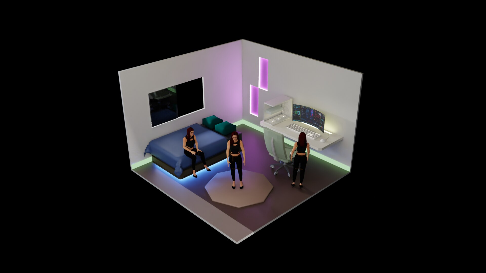

# OpenBody2039 MAYA — MCP

> **Give AI Agents a Body.** Her name is **MAYA**.  
> Part of **[MAYA 3.0](https://www.ura2039.xyz)** — the end-to-end IoT agent stack from LEGEND.  
> Landing: [live](https://rerelegend.github.io/openbody2039-maya/) · Blog: **[www.ura2039.xyz](https://www.ura2039.xyz)** · [repo](https://github.com/RERELEGEND/openbody2039-maya)

<p align="center">
  
</p>

**MAYA 3.0** is our end-to-end IoT agent: from cloud mind → MCP body knowledge → live avatar motion.  
This repo ships the **OpenBody2039 MAYA MCP** body layer. Product vision, robotics notes, and the full agent story live on **[www.ura2039.xyz](https://www.ura2039.xyz)** — 热热的博客 / LEGEND.

Universal **Model Context Protocol** server for avatar **body knowledge** and **intent-level control**.

- **MAYA 3.0 IoT agent** — embodiment for agents that already think
- **IDE-agnostic** stdio MCP (Claude Desktop, Cursor, Cline, Continue, custom agents, …)
- **Self-contained knowledge** in `body-graph/` (works offline)
- **Optional live control** via local WebSocket bridge + any OpenBody-compatible viewer
- **Learn more** on the LEGEND blog: [www.ura2039.xyz](https://www.ura2039.xyz)

| | |
|---|---|
| Product | **MAYA 3.0** end-to-end IoT agent |
| Blog | [www.ura2039.xyz](https://www.ura2039.xyz) |
| Node | **≥ 20** |
| OS | Linux (Ubuntu 22.04 tested) / macOS should work |
| Deps | `@modelcontextprotocol/sdk` ^1 · `ws` ^8 |
| License | MIT |

## Why MAYA 3.0

Agents need more than chat. **MAYA 3.0** connects reasoning to a constrained, performable body — joints, expressions, intent primitives — so an IoT agent can wave, nod, stand, and stay alive in the scene.

Follow the roadmap and robotics write-ups on **[URA2039](https://www.ura2039.xyz)** (ROS2 · Linux · Python · agents).

## Quick start

```bash
npm install
npm run export:graph      # rebuild body-graph from avatar-source/
npm run test:mcp-offline  # no viewer required
npm run mcp               # stdio MCP (stdout = protocol only)
```

Optional live stack:

```bash
npm run bridge            # ws://127.0.0.1:8787
# open any OpenBody-compatible viewer with mcp mode enabled (often ?mcp=1)
```

## Register in any MCP host

```json
{
  "mcpServers": {
    "openbody2039-maya": {
      "command": "node",
      "args": ["/ABS/PATH/to/OpenBody2039_MAYA/mcp/server.js"],
      "env": {
        "OPENBODY_WS_URL": "ws://127.0.0.1:8787"
      }
    }
  }
}
```

See [docs/MCP.md](docs/MCP.md) and [mcp/clients.example.json](mcp/clients.example.json).

## What agents should call

| Tool / resource | Offline | Role |
|---|---|---|
| `openbody_info` | yes | Manifest |
| `body_lookup` | yes | Joints / axes / morphs / poses |
| `openbody://body-graph/*` | yes | Full graph resources |
| `maya_status` → `intent_do` / `plan_run` → `control_release` | needs bridge | Live control |

Prefer **intent / primitives** over joint-level tweaks. Bone names only from `body_lookup`.

## Ecosystem

| Surface | Link |
|---|---|
| **MAYA 3.0** IoT agent story & blog | [www.ura2039.xyz](https://www.ura2039.xyz) |
| This MCP landing (GitHub Pages) | [rerelegend.github.io/openbody2039-maya](https://rerelegend.github.io/openbody2039-maya/) |
| Source | [github.com/RERELEGEND/openbody2039-maya](https://github.com/RERELEGEND/openbody2039-maya) |

## Layout

```text
mcp/            stdio MCP server
brain/          intent → primitives
transport/      optional WS bridge process
body-graph/     exported knowledge (do not hand-edit)
avatar-source/  SSOT for export:graph
docs/           MCP / protocol / layers + landing
skill/          optional Cursor Agent Skill (NOT required by MCP)
generator/      export + smoke tests
```

## Scope (v0)

**In scope:** protocol, body graph, MCP tools/resources, bridge — the body layer of **MAYA 3.0**.

**Out of scope (this repo):** full 3D avatar product binaries, GLB assets, Mixamo/AMASS motion corpora, proprietary viewer UI.

Product narrative and IoT agent architecture: **[www.ura2039.xyz](https://www.ura2039.xyz)**.  
Compatible viewers implement [docs/PROTOCOL.md](docs/PROTOCOL.md) themselves.

## Env

| Variable | Default |
|---|---|
| `OPENBODY_WS_URL` | `ws://127.0.0.1:8787` |
| `OPENBODY_GRAPH_DIR` | `<package>/body-graph` |
| `OPENBODY_CLIENT_ID` | `openbody-mcp` |
| `OPENBODY_AVATAR_SRC` | `<package>/avatar-source` (export only) |

## License

MIT — see [LICENSE](LICENSE).

---

**MAYA 3.0** · Give AI Agents a Body · Blog **[www.ura2039.xyz](https://www.ura2039.xyz)** · We are LEGEND.
